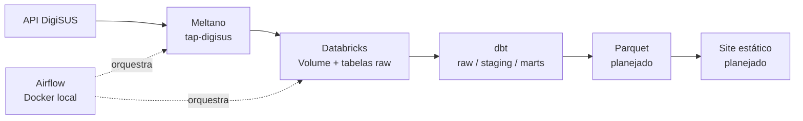

# DigiSUS Data Platform

Pipeline de dados que extrai os relatórios de planejamento do DigiSUS (API pública do Ministério da Saúde), carrega os dados brutos no Databricks e os modela com dbt. O objetivo final é exportar os marts em Parquet para um site estático.

**Site:** `<em breve>`

## Arquitetura



## Stack

- **Extração:** Meltano + tap customizado (Meltano Singer SDK), saída em Parquet
- **Orquestração:** Airflow 3 em Docker Compose (execução local)
- **Armazenamento e processamento:** Databricks (Free Edition), via Databricks CLI
- **Modelagem:** dbt (`dbt-databricks`)
- **Exportação e site:** planejados

## Estrutura

| Pasta | Conteúdo |
|---|---|
| [airflow/](airflow/README.md) | Dockerfile e DAGs |
| [extraction/](extraction/README.md) | Projeto Meltano e `tap-digisus` |
| [transform/](transform/README.md) | Projeto dbt |
| [export/](export/README.md) | Exportação dos marts para Parquet (planejado) |
| [docs/](docs/README.md) | Decisões (ADRs) e dicionário de dados |
| `site/` | Planejado, ainda não existe |

## Como rodar localmente

Pré-requisitos: Docker com Compose e uma conta Databricks (catálogo, schema e Volume já criados).

```bash
cp .env.example .env        # preencha os valores (ver comentários no arquivo)
docker compose up airflow-init
docker compose up -d --build
```

Airflow em http://localhost:8080 (usuário e senha padrão `airflow`/`airflow`, definidos por `_AIRFLOW_WWW_USER_*`). A DAG `digisus_extraction` é criada pausada e roda no dia 1 de cada mês; para executar manualmente, ative-a na interface e use *Trigger*.

> Atenção: uma execução completa chama a API do DigiSUS para todos os municípios e consome cota do Databricks.

A modelagem roda separadamente, veja [transform/](transform/README.md).

## Status do projeto

| Etapa | Estado |
|---|---|
| Extração (tap-digisus + Meltano) | Pronta |
| Orquestração (DAG mensal, Docker local) | Pronta |
| Carga no Databricks (Volume) | Pronta |
| Modelagem dbt | **Em andamento**: só `stg_base_planejamento` está versionado; marts ainda não existem |
| Exportação para Parquet | Planejada |
| Site estático | Planejado |
| CI (`.github/workflows/`) | Não existe |

## Decisões de projeto

- **Recarga completa** a cada execução, por simplicidade e idempotência ([ADR 0001](docs/decisions/0001-recarga-completa.md)).
- **Execução local, best-effort**, sem SLA ([ADR 0002](docs/decisions/0002-execucao-local-best-effort.md)).
- **Databricks Free Edition como processamento**, não como camada de serving ([ADR 0003](docs/decisions/0003-databricks-como-processamento.md)).
- **Monorepo** ([ADR 0004](docs/decisions/0004-monorepo.md)).
